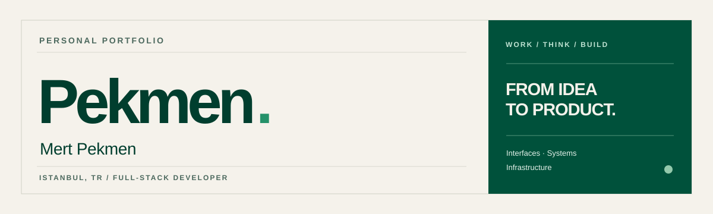

  

  <strong>Design-minded development, from interface to infrastructure.</strong> 
  I build digital products that are clear, fast and easy to maintain.

  <a href="https://pekmen.net">Portfolio</a> &nbsp;·&nbsp;
  <a href="https://pekmen.net/projects/">Selected work</a> &nbsp;·&nbsp;
  <a href="https://linkedin.com/in/pekmen/">LinkedIn</a> &nbsp;·&nbsp;
  <a href="mailto:contact@pekmen.net">Email</a>

 

### Selected work

| Project | What it does | Explore |
| :-- | :-- | :-- |
| **BarBer** | Salon discovery, appointment booking and live queues. | [Case study ↗](https://pekmen.net/projects/barber/) |
| **boyacı.net** | A fast, mobile-first website for a local painting business. | [Case study ↗](https://pekmen.net/projects/boyaci/) |
| **pekmen.net** | My portfolio, including a booking system and its administration workspace. | [Behind the build ↗](https://pekmen.net/projects/pekmen-net/) |

### Where I work

`TypeScript` · `Astro` · `Node.js` · `Cloudflare Workers` · `SQL` · `Linux` · `APIs` · `UI engineering`

I like working across the whole product: interfaces people enjoy using, systems that behave predictably, and the infrastructure underneath. Based in **Istanbul, Türkiye**.

---

  <small>Less noise. Better products.</small> 
  <a href="https://pekmen.net"><strong>pekmen.net ↗</strong></a>

